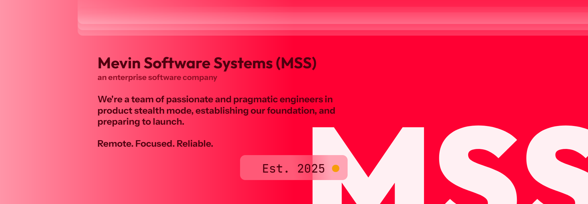

---

## `Hi there`, 👋

We are a lean remote team 📍🌍  **`(GMT+2)`**

We're a team of passionate and pragmatic software engineers in the business software sector, Our mandate is to build software that meets African enterprises where they are, to the standard of anywhere in the world.  

>> 📌 **Local understanding.**  
>> 📌 **Global engineering standards.**   
>> 📌 **No compromise on either.**  

Visit our [**website**](https://www.mevinsystems.online) for more.

## `Here's some of the techstack tools We use:` 🔨

<!--
## `Welcome` 👋

We're MSS – an enterprise software company in our inception phase. 🚀
Building robust, scalable solutions that work across industries.
We're **progressive**, **pragmatic**, and **passionate** about creating software that delivers real impact.

Currently in stealth mode, identifying the right problems to solve and the industries where we can create the most value.

 

## `Our Principles` 💡

| | |
|:---|:---|
| Progressive |Forward-thinking technology and modern architectures|
| Pragmatic |  Real-world solutions that actually work |
| Passionate  | Excellence in everything we build |
| Honest  |  Transparent communication, ethical practices |
| Powerful |  Software that drives real business value |
|  |  |

 

## `What We're Building` 🛠️

Right now? We're in the **ideation phase** – researching, planning, and laying the foundation.
Watch this space as we transition from planning to **shipping**.

**Focus areas:**

- Enterprise-grade systems
- Cloud-native architectures
- Security-first design
- Multi-industry scalability

 

## `Our Tech Stack` 🔧

###### * Modern, battle-tested technologies for enterprise scale 🎯

 

---

---

## `Join the Journey` 🚀

MSS is just getting started. Want to follow along?

- ⭐ **Star** this org to stay updated
- 👀 **Watch** for our first product launches
- 🔔 **Follow** our progress from inception to impact

-->

 

---

| 🔭  | &rdquo;Building the future of enterprise software&ldquo; |
|---|---|
